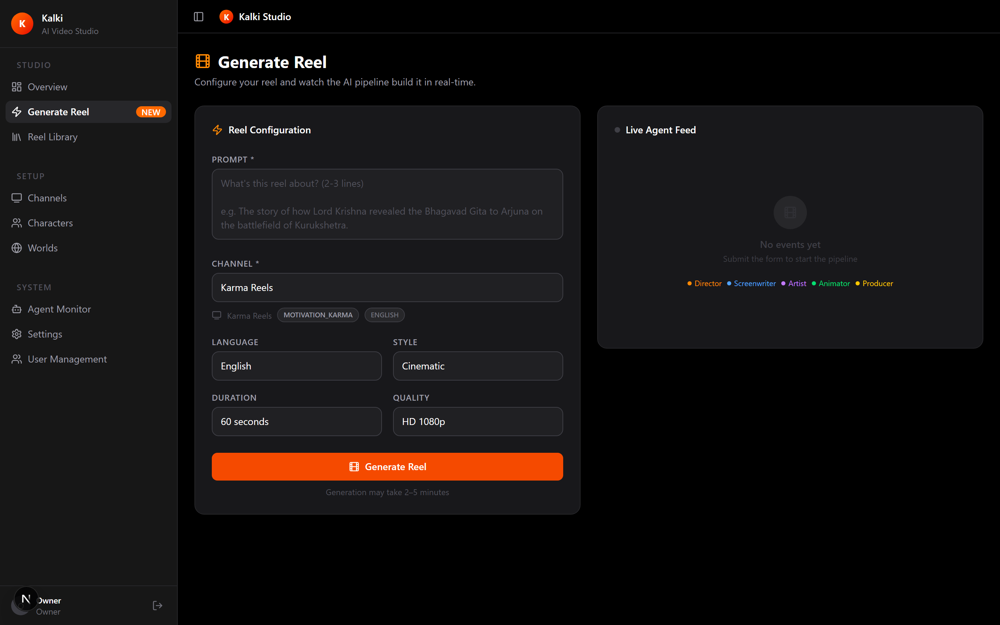
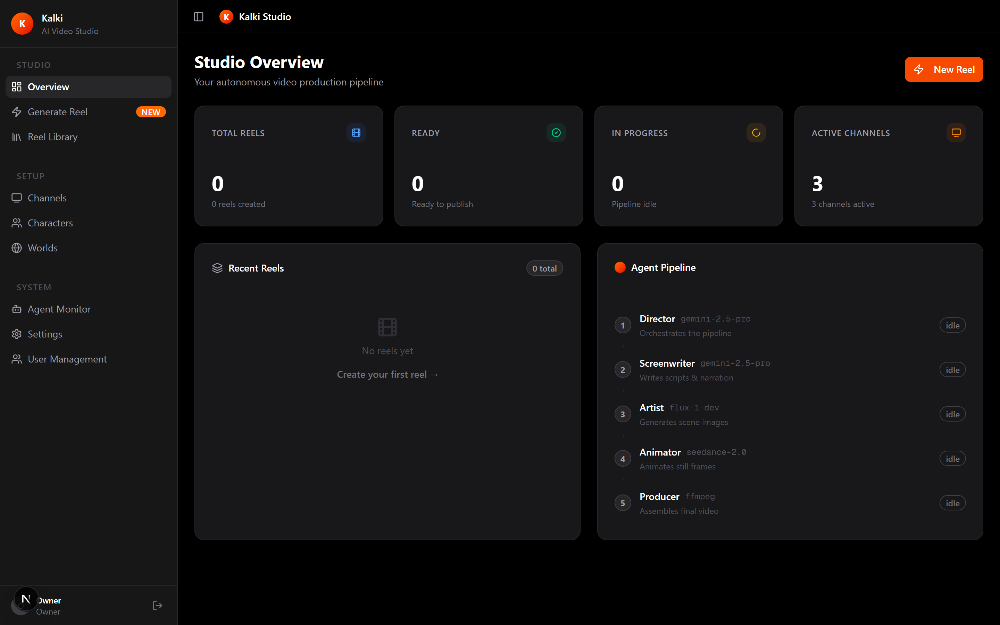
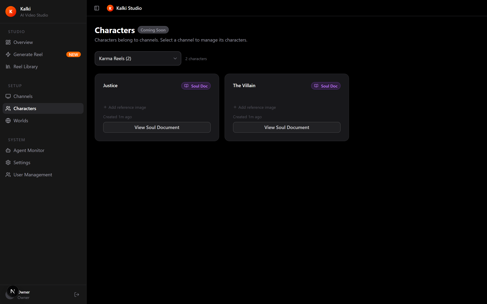
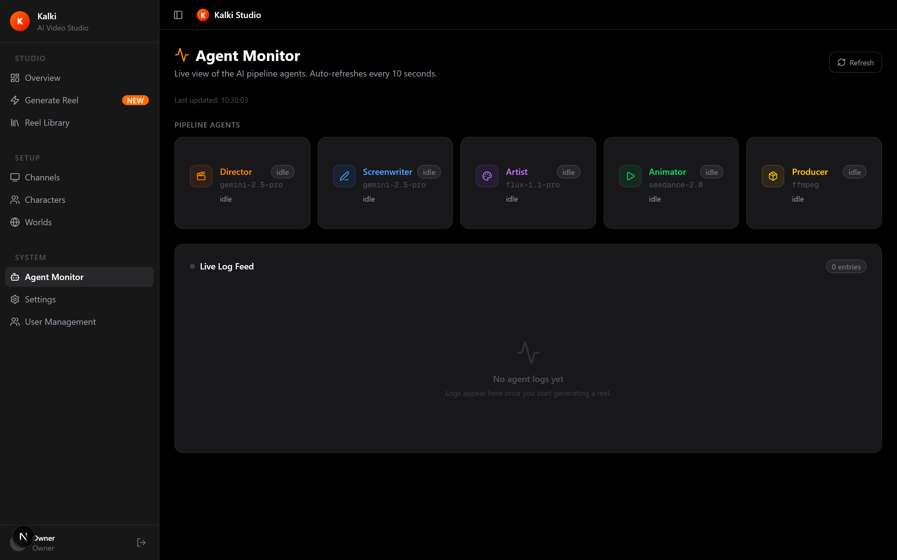
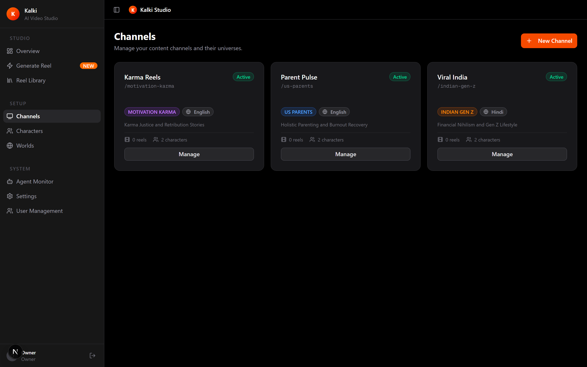

<p align="center">
  
</p>

<h1 align="center">Kalki</h1>

<p align="center">
  <b>Open-source AI short-video studio. Five agents turn one line of text into a finished vertical video, with captions ready for every platform.</b>
</p>

<p align="center">
  <a href="https://github.com/harshitwandhare/kalki/actions/workflows/ci.yml"></a>
  <a href="https://github.com/harshitwandhare/kalki/actions/workflows/codeql.yml"></a>
  <a href="https://securityscorecards.dev/viewer/?uri=github.com/harshitwandhare/kalki"></a>
  <a href="https://github.com/harshitwandhare/kalki/releases"></a>
  <a href="LICENSE"></a>
  <a href="https://conventionalcommits.org"></a>
</p>

<p align="center">
  <a href="https://kalki-studio.vercel.app"><b>Website</b></a> ·
  <a href="https://kalki-studio.vercel.app/docs/getting-started"><b>Docs</b></a> ·
  <a href="https://kalki-studio.vercel.app/docs/earning"><b>Earning guide</b></a> ·
  <a href="https://github.com/harshitwandhare/kalki/releases"><b>Releases</b></a>
</p>

<p align="center">
  
</p>

You write a one-line idea and pick a channel. A LangGraph director hands it down a line of agents: research, script, scene art, animation, voiceover, edit. A few minutes later there is a 9:16 MP4 in your library with a title, description and tags, plus a caption sized for YouTube Shorts, TikTok, Instagram Reels, Facebook Reels, Snapchat, Pinterest, X and LinkedIn.

It runs on your own machine with your own API keys. Nothing is uploaded for you, and every file is labelled as AI-generated.

## Contents

- [How it works](#how-it-works)
- [Features](#features)
- [Quick start](#quick-start)
- [Run it in Docker](#run-it-in-docker)
- [Publishing and earning](#publishing-and-earning)
- [Responsible use](#responsible-use)
- [Documentation](#documentation)
- [Development](#development)
- [Project layout](#project-layout)
- [Security](#security)
- [License](#license)

## How it works

```
prompt -> Director -> Screenwriter -> Artist -> Animator -> Producer -> reel + captions
           research     script and      one image   Seedance    merge, label,
           and cast     metadata        per scene   or Kling    thumbnail
```

| Agent        | Job                                                                              | Provider                        |
| ------------ | -------------------------------------------------------------------------------- | ------------------------------- |
| Director     | Loads the channel, cast and world, researches the topic                          | Gemini 2.5 Pro                  |
| Screenwriter | Writes hook, scenes and voiceover to the length you chose, plus metadata         | Gemini 2.5 Pro                  |
| Artist       | Draws every scene and a thumbnail                                                | Stability AI                    |
| Animator     | Animates the scenes with up to 12 character references                           | Seedance 2.0, Kling as fallback |
| Producer     | Merges clips with the voiceover, tags the file as AI-generated, cuts a thumbnail | ElevenLabs, FFmpeg              |

Every step is written to Postgres and streamed to the dashboard over Server-Sent Events, so you watch the run happen. The full walk-through is in [docs/pipeline.md](docs/pipeline.md).

## Features

- **Channels with a recurring cast.** Each channel has an audience, language and opening hooks. Characters carry soul documents (looks, voice, quirks, backstory) and reference images so they look the same from episode to episode. Three demo channels ship as seed data.
- **Similarity search.** Characters and worlds are embedded with pgvector, so you can find the right cast for a new idea.
- **Every platform from one file.** The Library writes a caption per platform inside its limits and tells you where that platform's AI label is. See [docs/publishing.md](docs/publishing.md).
- **Length you control.** 30 to 90 seconds. Use 75 or 90 for TikTok's Creator Rewards, which only counts videos over a minute.
- **Roles and approvals.** Owner, editor and viewer roles. New sign-ups wait for an owner to approve them.
- **Optional WhatsApp control.** Start a reel or check status by message through a gateway you run. Off unless configured, and it can't run commands.
- **Honest output.** Provenance tags on every file. No stripping of C2PA or SynthID, no fake device metadata.

|                                                                                                       |                                                                                        |
| ----------------------------------------------------------------------------------------------------- | -------------------------------------------------------------------------------------- |
|  |   |
| **Overview.** Reel counts, channels and agent status.                                                 | **Characters.** A recurring cast per channel.                                          |
|                          |  |
| **Agent monitor.** Every step, live.                                                                  | **Channels.** Audience, language and hooks.                                            |

## Quick start

You need [Bun](https://bun.sh) 1.3+, Docker, FFmpeg and a [Gemini API key](https://aistudio.google.com/app/apikey).

```bash
git clone https://github.com/harshitwandhare/kalki && cd kalki
bun run setup
bun run dev
```

`bun run setup` writes `.env.local` with fresh secrets, asks for your Gemini key, starts Postgres, applies migrations and creates your owner account. Open http://localhost:3000 and sign in.

Image, voice and video keys are optional and per provider. Add them to `.env.local` when you want those stages: `STABILITY_API_KEY`, `ELEVENLABS_API_KEY`, and `SEEDANCE_API_KEY` or `KLING_API_KEY`. Every variable is described in [docs/configuration.md](docs/configuration.md). Prefer to do it by hand? Follow [docs/getting-started.md](docs/getting-started.md).

## Run it in Docker

```bash
cp .env.example .env.local        # set AUTH_SECRET, POSTGRES_PASSWORD and your keys
export POSTGRES_PASSWORD=...      # same value as in .env.local
docker compose -f docker/docker-compose.yml --profile app up -d --build
```

The image includes FFmpeg, applies migrations on start, and keeps finished videos in a named volume. Create the owner account once with `bun run db:seed` (see the deployment guide).

## Publishing and earning

Kalki never posts for you. You review the reel, copy the caption for the platform you want, and upload it with the platform's AI label switched on.

If you want the channel to earn, read [docs/earning.md](docs/earning.md) before you start. It covers what YouTube, TikTok, Instagram and Facebook will and won't pay for (mass-produced AI clips get demonetized), the thresholds for each program, and the income that usually matters more: brand deals, affiliate links, and making reels for other businesses. It also explains how to work out your cost per reel from your provider bills before you scale.

## Responsible use

- Every output file carries `comment=AI-generated content (created with Kalki)`.
- Kalki only uses API keys you supply. It has no code to create accounts, solve CAPTCHAs, rotate proxies or evade detection.
- Turn on each platform's AI disclosure when you post. The Library tells you where it is.
- Don't impersonate real people or use anyone's likeness without consent.

`tests/policy.test.ts` fails the build if account-farming or metadata-stripping code comes back. More in [docs/responsible-use.md](docs/responsible-use.md).

## Documentation

| Guide                                       | What it covers                                             |
| ------------------------------------------- | ---------------------------------------------------------- |
| [Getting started](docs/getting-started.md)  | Manual install, step by step                               |
| [Configuration](docs/configuration.md)      | Every environment variable                                 |
| [The pipeline](docs/pipeline.md)            | What each agent does and in what order                     |
| [Architecture](docs/architecture.md)        | Layers, data model, real-time updates, security boundaries |
| [API](docs/api.md)                          | Every route, its role and payload                          |
| [Deployment](docs/deployment.md)            | Self-hosting, the public site, releases                    |
| [Publishing everywhere](docs/publishing.md) | Platform presets, captions and disclosure                  |
| [Earning with Kalki](docs/earning.md)       | Monetization programs, thresholds and costs                |
| [Responsible use](docs/responsible-use.md)  | Provenance, disclosure and likeness rules                  |

The same docs are on the [website](https://kalki-studio.vercel.app/docs/getting-started).

## Development

```bash
bun run check          # eslint, tsc, vitest
bun run format:check   # prettier
bun run e2e            # Playwright against a production build (E2E_MODE=site or app)
bun run db:studio      # browse the database
```

CI runs lint, format, types, unit tests, a production build, migrations on a fresh pgvector database, end-to-end tests for the public site and for the full app with a seeded database, a gitleaks scan of the whole history and a dependency audit. CodeQL and OpenSSF Scorecard run weekly, and Dependabot keeps the SHA-pinned actions and packages current.

Commits follow [Conventional Commits](https://conventionalcommits.org). See [CONTRIBUTING.md](CONTRIBUTING.md).

## Project layout

```
src/agents/director.ts      the LangGraph pipeline, all five agents
src/services/               image, video, audio, ffmpeg, embeddings, SSE, pipeline start
src/lib/                    auth, roles, API guard, platform presets
src/app/(dashboard)/        the studio
src/app/(site)/             the public website and docs
src/app/api/                REST, SSE and the WhatsApp webhook
prisma/                     schema, migrations, seed
docs/                       guides, also rendered on the website
e2e/ tests/                 Playwright and Vitest
scripts/                    setup, screenshots, logo rendering
```

## Security

Please report vulnerabilities privately. See [SECURITY.md](SECURITY.md).

## The name and the mark

Kalki is the tenth avatar of Vishnu, who closes one age and opens the next. The mark borrows from Shiva: the three ash lines of the tripundra, crossed by the third eye. Its pupil is a play button, and the tip of Kalki's sword rises above it. The emblem is rendered with three.js by `scripts/logo-render.mjs`, and the flat mark by `scripts/logo.mjs`.

## License

[MIT](LICENSE). Made by [Harshit Wandhare](https://harshitwandhare.com).
